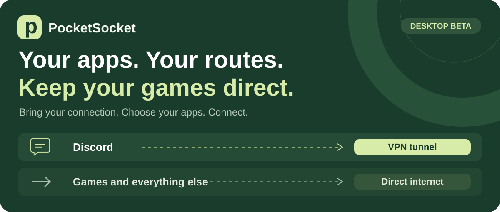
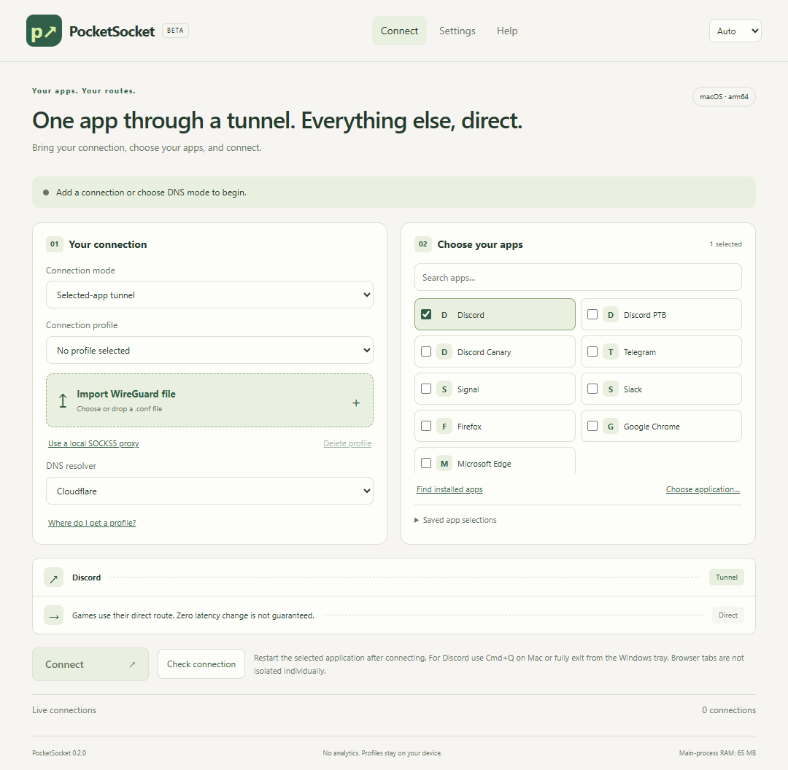

<p align="center"></p>
<p align="center"><strong>Free · Open source · Windows / macOS / Linux · English / Türkçe</strong></p>
<p align="center"><a href="README.md">Türkçe</a> · <a href="https://github.com/rubarbulut/PocketSocket/releases"><strong>📥 DOWNLOAD</strong></a> · <a href="#connect">🟢 Connect</a> · <a href="#installation-help">🛟 Help</a></p>

> **Public beta.** Bring your own WireGuard internet profile or compatible **localhost SOCKS5 proxy**. PocketSocket provides no VPN servers or accounts. Encrypted DNS mode is also available; it cannot bypass every access restriction.

## Download and install

**[Open the download page →](https://github.com/rubarbulut/PocketSocket/releases)** No GitHub account required. [All release files, corresponding source and SHA256SUMS](https://github.com/rubarbulut/PocketSocket/releases).

| Device | Package |
| --- | --- |
| **MacBook Neo / A18 Pro**, or M-series Mac | **mac-arm64.dmg** |
| Intel Mac | **mac-x64.dmg** |
| Windows 11 · x64 | **win-x64.exe**, or portable EXE |
| Desktop Linux · x64 | **linux-x64.AppImage**, or tar.gz |

Mac requires macOS 13+. Linux routing requires PolicyKit and a desktop authentication agent. This release does not include an iPhone or Android application.

**Mac:** open DMG → drag PocketSocket to Applications → open it. **Windows:** run the installer, or keep the portable EXE in a permanent folder. **Linux:** make the AppImage executable; if FUSE is unavailable, unpack the tar.gz and run `pocketsocket`.

## Connect

1. **Choose a mode:** selected-app tunnel, encrypted DNS, or smart detection.
2. **Add your connection:** select/drop your WireGuard `.conf` file or enter your localhost SOCKS5 details.
3. **Choose your apps:** presets include Discord variants, Telegram, Signal, Slack and browsers. Discover installed applications or select an executable/app bundle manually.
4. **Connect** → approve the OS administrator prompt → restart the selected app. Test Discord text, voice and microphone separately.



**Live connections** should show **Tunnel** for selected applications and **Direct** for others. Selecting a browser affects the **whole browser**, not just one tab.

<details><summary>Where do I get a connection?</summary>

Look for **WireGuard / manual setup / configuration download** in your provider account. The app links to setup pages; these are not account integrations or sponsored recommendations. Availability, subscription requirements and quotas depend on your provider. Do not share the `.conf`: it contains a private key. Custom scripts and nonstandard WireGuard fields are rejected.

If an existing provider app exposes a localhost SOCKS5 proxy, add it and keep that app running. UDP support must be supplied by the provider app; enabling a checkbox does not add it. Disable that provider’s system-wide VPN tunnel if you want other applications to remain direct. Not every VPN app supports this method.

</details>

## Connection modes

| Mode | Behavior |
| --- | --- |
| Selected-app tunnel | Selected applications use your profile; others use direct outbound routing. |
| Encrypted DNS | Device-wide DNS traffic is handled by the local engine and an encrypted resolver. It does not change your country. |
| Smart detection | Tests Discord HTTPS directly, then with encrypted DNS, before choosing your profile if needed. It does not prove voice works. |

DNS mode affects the device’s DNS traffic. Tunnel mode also uses a local TUN engine and DNS interception. Local processing, DNS resolution and shared bandwidth can affect latency. **Zero ping change is not guaranteed.**

**Check connection** measures real profile outbound and Discord HTTPS access. Reported HTTP latency is **not game ping**. Observed UDP traffic does not establish microphone or voice quality. Specific ISPs, providers, Discord voice/screen sharing and concurrent gaming need real-world testing.

## Installation help

This free distribution has **no paid Apple Developer ID/notarization or Windows publisher certificate**. Mac packages use an ad-hoc integrity signature. OS trust warnings may still appear. Signed update manifests are independent of OS publisher signing.

### macOS: “damaged” / unidentified developer

Move the app to Applications and try opening it. Check **System Settings → Privacy & Security → Open Anyway**. [Apple’s guide](https://support.apple.com/en-us/102445).

For a trusted copy downloaded from this project, this removes only PocketSocket’s download quarantine:

```sh
xattr -rd com.apple.quarantine "/Applications/PocketSocket.app"
```

It does not repair a damaged file or invalid signature. If the error continues, report its exact text.

### Windows: trust warning

Check the release and **SHA256SUMS**. If SmartScreen offers **More info → Run anyway**, use it only for the copy you verified. Smart App Control or an administrator policy can still block unsigned software. Do not disable device-wide security protection.

### Linux: launch / permission issue

Make the AppImage executable or use the tar.gz archive. Routing needs `/usr/bin/pkexec` and a working desktop authentication agent. If an OS-backed key store is unavailable, profiles remain session-only.

These instructions are also available inside **Help**.

## Everyday features

- English/Turkish with system-language detection; system/light/dark appearance.
- Multiple profiles saved with OS-backed encryption, or session-only operation when protected storage is unavailable.
- Application search/discovery, custom application selection and named app-selection recipes.
- Tray/menu-bar connection controls; optional keep-running-on-close behavior.
- Optional login startup on Mac/Windows and optional connection on app start. Startup connection can request OS administrator permission.
- Network/wake checks and outbound recovery while the engine runs. A stopped engine requires a user-initiated reconnect; no background administrator prompt is opened.
- Explicit block/direct fallback policy for selected apps while the engine runs. Direct fallback may expose your normal IP.
- Stable/beta update channels, pinned-key signed manifest validation and file checksum verification. Downloaded installers are launched by you when convenient; games are not interrupted. [Earlier releases / rollback](https://github.com/rubarbulut/PocketSocket/releases).

**This is not a crash-proof OS kill switch.** If the engine stops, ordinary system routing returns. Unrecognized app traffic can be direct; check the live connection view. Apps using shared system helpers may need additional rules.

## Privacy and support

No PocketSocket analytics or browsing-history collection. Profiles stay on your device. Connection checks contact Discord and Google’s connectivity endpoint; smart DNS detection also contacts Cloudflare. Update checks use GitHub. [Privacy details](docs/PRIVACY.md).

**Help → Save support report** exports an allowlisted report without private keys, profile names, user paths, IPs or connection destinations. Review it before sharing. [Report an issue](https://github.com/rubarbulut/PocketSocket/issues); never attach a `.conf` file or password.

---

[Türkçe](README.md) · [Technical notes](docs/TECHNICAL.md) · [Test coverage](docs/TEST_MATRIX.md) · [Changes](CHANGELOG.md) · [Security](SECURITY.md) · [Third-party notices](THIRD_PARTY_NOTICES.md) · [GPL-3.0](LICENSE)
