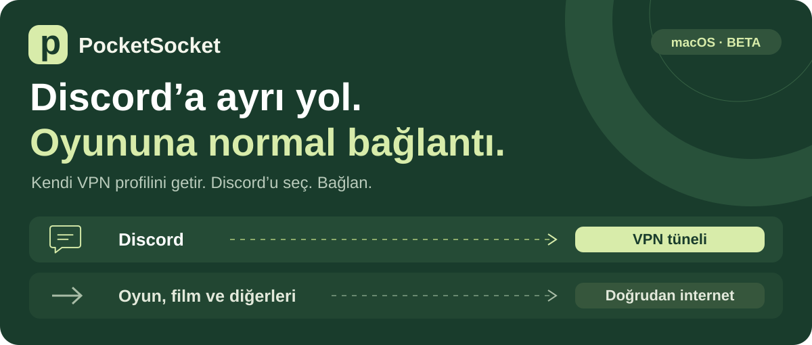
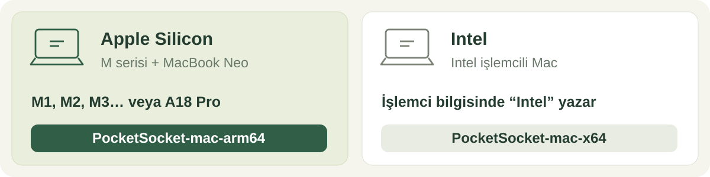
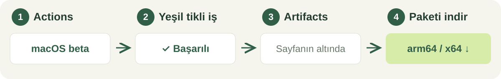
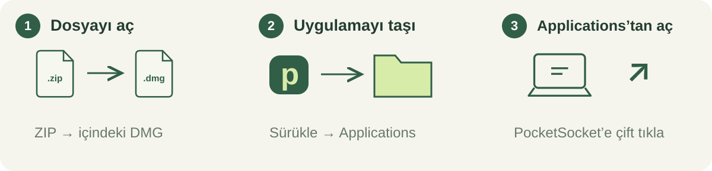
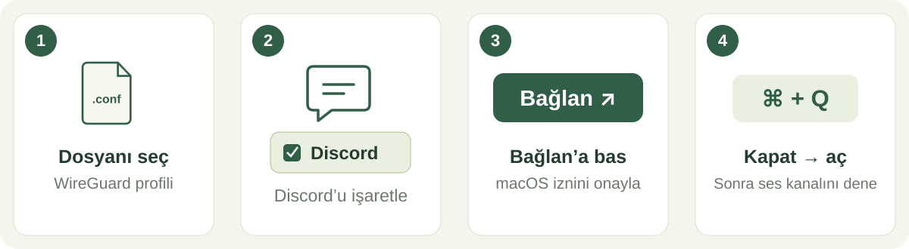
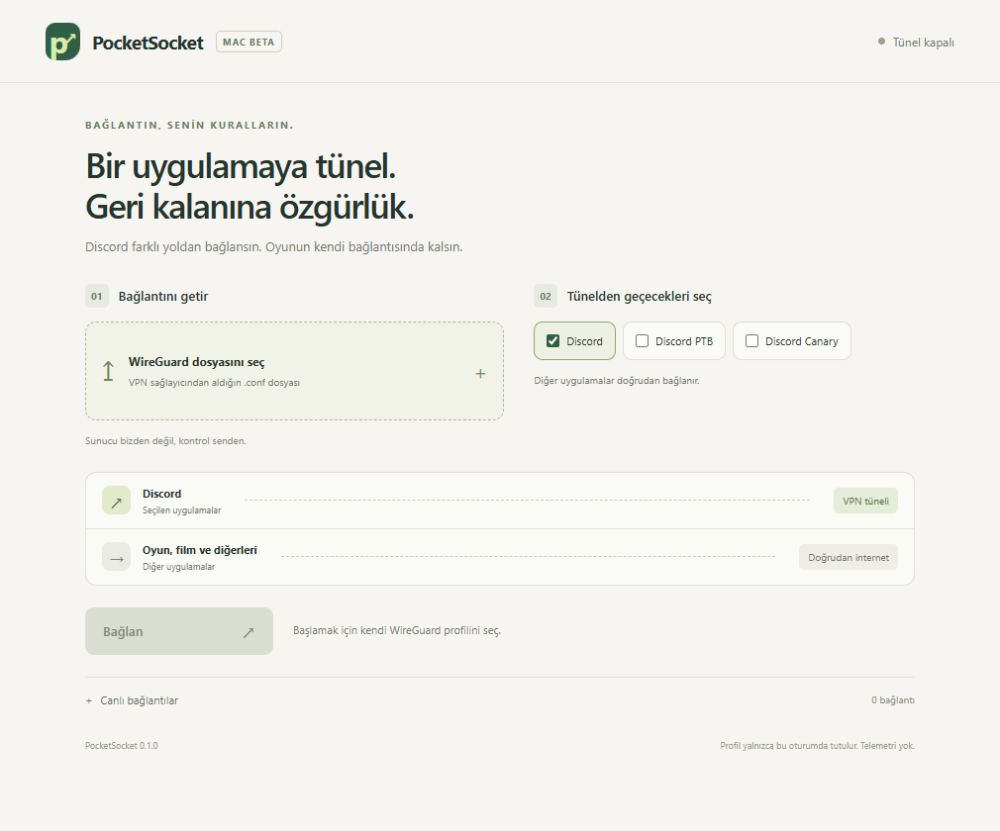
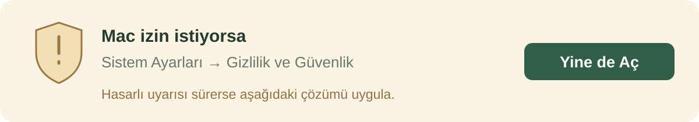

<p align="center">
  
</p>

<p align="center">
  <strong>Discord’u seç. Bağlan. Diğer uygulamalar kendi bağlantısından devam etsin.</strong>
</p>

<p align="center">
  <a href="#1--macine-uygun-paketi-indir">📥 İndir</a> ·
  <a href="#2--kur">📦 Kur</a> ·
  <a href="#3--discordu-bağla">🟢 Bağlan</a> ·
  <a href="#açılmıyor-mu">🛟 Açılmıyor mu?</a>
</p>

> **Başlamak için iki şey gerekiyor:** macOS 13 veya üzeri bir Mac ve VPN sağlayıcından alınmış bir **WireGuard `.conf` dosyası**.
>
> PocketSocket sunucu veya VPN hesabı vermez. Bu sürüm yalnızca DNS değiştirerek çalışmaz.

## 1 · Mac’ine uygun paketi indir



**MacBook Neo / M serisi → arm64. Intel → x64.**

İşlemcini bilmiyor musun? **Apple menüsü → Bu Mac Hakkında** ekranına bak.

<p align="center">
  <a href="https://github.com/rubarbulut/PocketSocket/actions/workflows/macos.yml"><strong>📥 İNDİRME SAYFASINI AÇ</strong></a>
</p>



**Yeşil tikli** bir çalışmayı aç. Altındaki **Artifacts** bölümünden görseldeki paketini seç. `UI-check` dosyaları uygulama değildir.

<details>
<summary>İndirme görünmüyor mu? / Dosyayı arkadaşına mı göndereceksin?</summary>

Repo private olduğu için GitHub’a giriş ve repo erişimi gerekir. Erişimi olmayan arkadaşına indirdiğin arşivi kendin gönderebilirsin. Kaynak kod ve lisans dosyalarını da arşivin içinde bırak.

GitHub bu indirmeleri 14 gün saklar. Süresi dolmuşsa **macOS beta → Run workflow** ile yeni paket üretilebilir; bu seçenek repo yetkisi ister.

</details>

## 2 · Kur



**ZIP’i aç → DMG’yi aç → PocketSocket’i Applications’a taşı → uygulamayı aç.**

“Hasarlı” veya “geliştirici doğrulanamıyor” diyorsa [açılış çözümüne geç](#açılmıyor-mu).

## 3 · Discord’u bağla



1. **WireGuard dosyasını seç** → kendi `.conf` dosyanı aç.
2. **Discord** kutusunu işaretle. PTB veya Canary kullanıyorsan onu seç.
3. **Bağlan** → macOS’un yönetici izin penceresini onayla.
4. Discord’u **⌘ + Q** ile tamamen kapat. Tekrar aç ve **ses kanalına gir**.

Bağlamadan önce diğer VPN uygulamalarını kapat; aynı anda çalışan başka bir VPN yönlendirmeyi etkileyebilir.

<details>
<summary>📄 .conf dosyam yok. Nereden alacağım?</summary>

Kullandığın VPN sağlayıcısının hesabında **WireGuard**, **manuel kurulum** veya **yapılandırma indir** bölümünü ara. Dosya adı genellikle `.conf` ile biter.

Her sağlayıcı ve her ücretsiz plan bu dosyayı vermez. Rastgele internetten bulduğun bir profil yerine kendi sağlayıcının verdiğini kullan. Dosyanın içinde özel anahtarın bulunur; kimseyle paylaşma.

PocketSocket bu ilk sürümde başka bir VPN uygulamasını otomatik yönetmez; sağlayıcının dosyasıyla kendi bağlantısını kurar. Ayrı WireGuard uygulaması, Node.js veya Homebrew kurmana gerek yok.

</details>

### Uygulamada göreceğin ekran



*Uygulama kodundan alınmış örnek başlangıç ekranı; aktif VPN bağlantısı göstermez. Diğer görseller adımları anlatan şemalardır.*

## 4 · Çalıştığını kontrol et

**Canlı bağlantılar** bölümünü aç. Yeni bağlantılarda şu yolları görmelisin:

| 💬 Discord | 🎮 Oyun / film / diğer uygulamalar |
| :---: | :---: |
| **Tünel** | **Doğrudan** |

**Mesaj gönder → ses kanalına gir → mikrofonu dene.** Bitirdiğinde **Bağlantıyı kes** düğmesine bas.

> **“Yönlendirme etkin” yazısı tek başına Discord’un çalıştığını göstermez.** Gerçek sunucu erişimini ve sesi yukarıdaki adımlarla dene. Türkiye’de erişim ve oyun ping’i henüz gerçek kullanıcı bağlantısında doğrulanmadı.

## Açılmıyor mu?



### “Geliştirici doğrulanamıyor” / “Uygulama hasarlı”

Bu beta henüz Apple Developer sertifikasıyla imzalı ve noter onaylı değil. macOS indirme veya imza nedeniyle engelleyebilir; **her “hasarlı” uyarısının nedeni aynı değildir.**

1. Uygulama **Applications / Uygulamalar** klasöründe olsun.
2. Bir kez açmayı dene, sonra **Sistem Ayarları → Gizlilik ve Güvenlik → Yine de Aç** seçeneğine bak. [Apple’ın açılış rehberi](https://support.apple.com/en-us/102445).
3. Uyarı sürüyorsa, **kaynağını doğruladığın PocketSocket test paketi için** Terminal’i aç, aşağıdaki satırı yapıştır ve Enter’a bas:

```sh
xattr -rd com.apple.quarantine "/Applications/PocketSocket.app"
```

4. PocketSocket’i tekrar aç.

Bu komut yalnızca bu uygulamanın indirme karantinasını kaldırır; bozuk dosyayı veya geçersiz imzayı onarmaz. Hata devam ederse **tam hata metnini** ve Mac modelini [sorun bildirirken](https://github.com/rubarbulut/PocketSocket/issues) yaz. `.conf` dosyanı veya özel anahtarını ekleme.

<details>
<summary>🟢 Bağlan düğmesi neden pasif?</summary>

Önce geçerli bir `.conf` dosyası aktar ve en az bir Discord sürümünü seç. Tünel bu sürümde yalnızca macOS’ta çalışır.

</details>

<details>
<summary>💬 Discord açılıyor ama ses çalışmıyor.</summary>

Doğru Discord sürümünün seçili olduğunu kontrol et. Discord’u **⌘ + Q** ile kapatıp aç. **Canlı bağlantılar** bölümünde Discord’un `Tünel` yolunu kullandığını kontrol et. Profilin ve sunucun UDP trafiğini desteklemeli; uygulamanın açılması tek başına sesin de çalışacağını göstermez.

</details>

<details>
<summary>🎮 Oyunumun ping’i kesin aynı mı kalır?</summary>

Oyun trafiği VPN sunucusuna gönderilmez. Ama yerel motorun yükü, DNS çözümlemesi ve aynı internet hattını kullanan indirme/yayınlar gecikmeyi etkileyebilir. **Sıfır ping değişimi garantisi yok.**

</details>

<details>
<summary>🌐 Tarayıcıdaki Discord da kapsanıyor mu?</summary>

Bu sürüm Discord’un Mac uygulamalarını seçer. Tarayıcıdaki Discord kapsanmaz. Sadece DNS değiştirmek de her bağlantıda Discord’a erişmek için yeterli olmayabilir.

</details>

<details>
<summary>🔑 Uygulamayı yeniden açınca neden dosyayı tekrar seçiyorum?</summary>

Profil bu sürümde kalıcı kaydedilmez. Uygulamayı her açtığında yeniden içe aktarırsın. Yönetici parolanı PocketSocket toplamaz; izni macOS’un kendi penceresinde verirsin.

</details>

---

<p align="center">
  <a href="docs/TECHNICAL.md">Geliştirici ve teknik notlar</a> ·
  <a href="docs/MAC_TEST.md">Gerçek Mac test rehberi</a> ·
  <a href="THIRD_PARTY_NOTICES.md">Bileşenler ve kaynak</a> ·
  <a href="LICENSE">GPL-3.0 lisansı</a>
</p>
