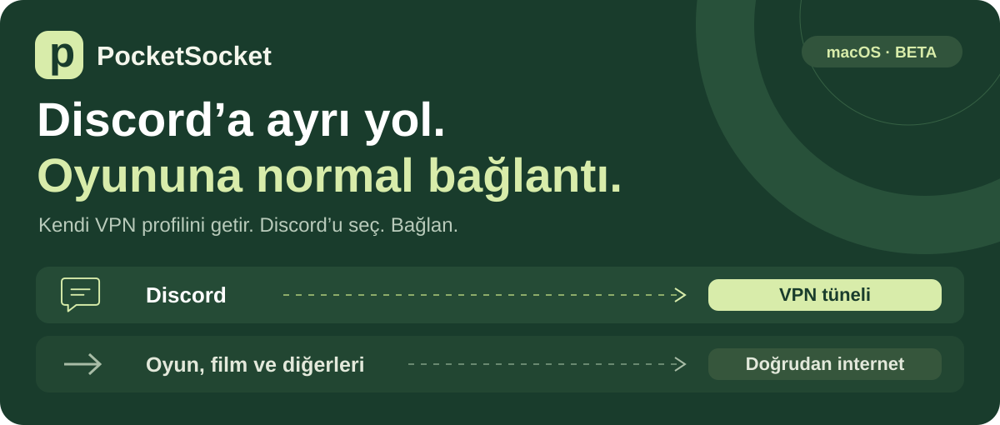
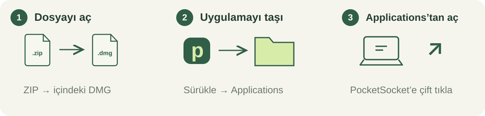
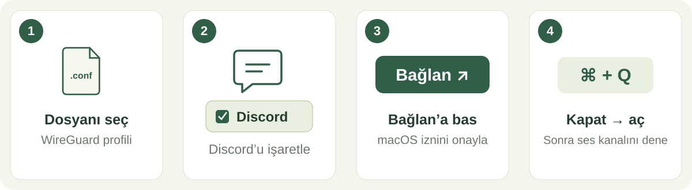
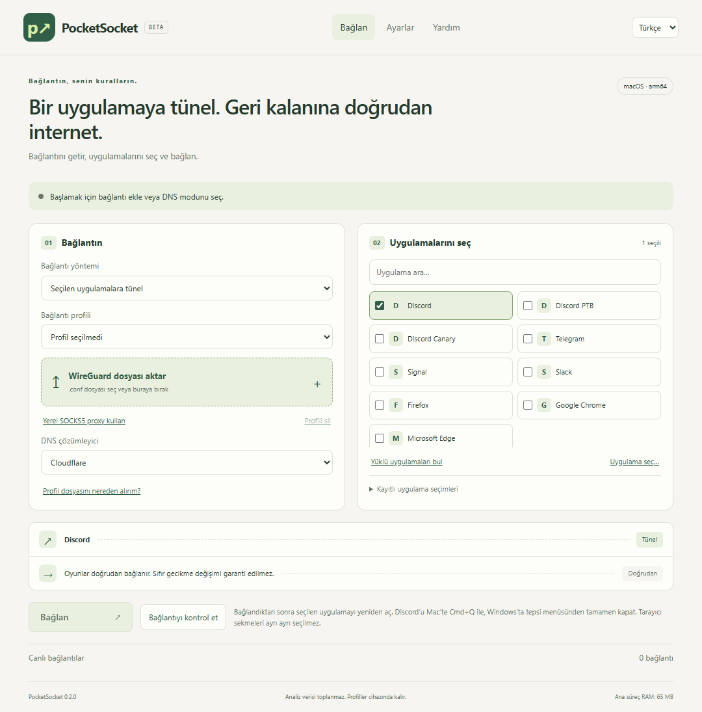

<p align="center"></p>
<p align="center"><strong>Ücretsiz · Açık kaynak · Windows / macOS / Linux · Türkçe / English</strong></p>
<p align="center"><a href="README.md">English</a> · <a href="https://github.com/rubarbulut/PocketSocket/releases"><strong>📥 İNDİR</strong></a> · <a href="#ilk-bağlantı">🟢 Bağlan</a> · <a href="#açılmıyor-mu">🛟 Yardım</a></p>

> **Public beta:** PocketSocket sunucu veya VPN hesabı vermez. Tünel için kendi WireGuard profilini veya uyumlu bir **yerel SOCKS5 proxy** getirirsin. Ücretsiz DNS modu da vardır; her erişim engelini aşmaz.

## 1 · Cihazını seç

**[İndirme sayfasını aç →](https://github.com/rubarbulut/PocketSocket/releases)** GitHub’a giriş yapman gerekmez. [Tüm yayın dosyaları, kaynak ve SHA256SUMS](https://github.com/rubarbulut/PocketSocket/releases).

| Cihaz | Paket |
| --- | --- |
| **MacBook Neo / A18 Pro** veya M serisi Mac | **mac-arm64.dmg** |
| Intel Mac | **mac-x64.dmg** |
| Windows 11 · x64 | **win-x64.exe**; ayrıca portable EXE |
| Masaüstü Linux · x64 | **linux-x64.AppImage**; ayrıca tar.gz |

Mac için macOS 13+, Linux yönlendirmesi için PolicyKit ve masaüstü izin aracısı gerekir. Bu sürüm iPhone/Android uygulaması değildir.

## 2 · Kur

**Mac:** DMG’yi aç → PocketSocket’i Applications’a taşı → aç.



**Windows:** EXE’yi aç → kur. Portable sürümü kullanıyorsan dosyayı kalıcı bir klasöre koy.

**Linux:** AppImage’a çalıştırma izni ver → aç. FUSE yoksa tar.gz arşivini açıp içindeki `pocketsocket` dosyasını çalıştır.

**İlk açılışta** kısa rehberi tamamla. Dil ve açık/koyu tema **Ayarlar** bölümündedir.

## İlk bağlantı



1. **Yöntemi seç:** uygulama tüneli, şifreli DNS veya akıllı algılama.
2. **Bağlantını ekle:** WireGuard `.conf` dosyasını seç/sürükle ya da yerel SOCKS5 bilgilerini gir.
3. **Uygulamalarını seç:** Discord, Telegram, Signal, Slack ve tarayıcı seçenekleri hazır. **Yüklü uygulamaları bul** veya **Uygulama seç** ile başka uygulama ekleyebilirsin.
4. **Bağlan** → sistemin yönetici iznini onayla → seçilen uygulamayı yeniden aç. Discord’da mesaj, ses ve mikrofonu ayrı ayrı dene.



**Canlı bağlantılar:** seçtiğin uygulamalarda **Tünel**, diğerlerinde **Doğrudan** görmelisin. Tarayıcı seçimi **tüm tarayıcıyı** etkiler; yalnızca Discord sekmesini seçmiş olmazsın.

<details><summary>📄 WireGuard dosyam yok. Nereden alırım?</summary>

Sağlayıcının hesabında **WireGuard / manuel kurulum / yapılandırma indir** bölümünü ara. Uygulama içindeki **Profil dosyasını nereden alırım?** bağlantısı kurulum sayfalarını gösterir. Her sağlayıcı veya ücretsiz plan bu dosyayı sunmaz; PocketSocket bu sınırı kaldırmaz. Bunlar hesap entegrasyonu veya sponsorlu öneri değildir.

`.conf` dosyasında özel anahtarın vardır: **paylaşma**. Script veya standart dışı protokol alanı olan profiller kabul edilmez.

</details>

<details><summary>🔌 Mevcut VPN uygulamamla kullanabilir miyim?</summary>

Uygulama bir **localhost SOCKS5 proxy** sunuyorsa yerel proxy olarak ekleyebilirsin. O uygulama açık kalmalı; Discord sesi için UDP desteğini de o sağlamalıdır. Kutuyu işaretlemek UDP desteği eklemez. Diğer uygulamaların doğrudan kalması için sağlayıcının cihaz genelindeki VPN tünelini kapatıp yalnız proxy yöntemini kullanman gerekebilir. Her VPN uygulaması bu yöntemi desteklemez.

</details>

## Üç bağlantı yöntemi

| Yöntem | Ne yapar? |
| --- | --- |
| **Seçilen uygulamalara tünel** | Seçtiğin uygulamaları kendi profilinden, diğerlerini doğrudan çıkarır. |
| **Şifreli DNS** | Cihazın DNS trafiğini yerel motor üzerinden şifreli çözümleyiciye gönderir. Ülkeni değiştirmez. |
| **Akıllı algılama** | Discord HTTPS erişimini önce doğrudan, sonra şifreli DNS ile dener; gerekirse profilini kullanır. Sesin çalıştığını kanıtlamaz. |

**DNS modu cihaz genelini etkiler.** Tünel modunda da yerel TUN motoru ve DNS yakalama çalışır. DNS sunucusu, yerel işlem yükü ve ortak internet hattının yoğunluğu diğer uygulamaların gecikmesini etkileyebilir. **Sıfır ping değişimi garantisi yoktur.**

## Kontrol et, tahmin etme

**Bağlantıyı kontrol et** gerçek profil çıkışını ve Discord HTTPS erişimini ayrı kontrol eder. Doğrudan/profil gecikmesi **HTTP testidir, oyun ping’i değildir**. UDP trafiği görülmesi mikrofon veya ses kalitesinin doğrulandığı anlamına gelmez.

Türkiye’de belirli sağlayıcı/ISS’lerde erişim, gerçek Discord sesi, ekran paylaşımı ve oyun gecikmesi için [gerçek cihaz test rehberi](docs/MAC_TEST.md) kullanılmalı. CI testleri bunları kanıtlamaz.

## Açılmıyor mu?

### Mac · “Hasarlı” / “Geliştirici doğrulanamıyor”

Bu ücretsiz yayında **ücretli Apple Developer ID veya noter onayı yok**. 0.2 Mac paketi ücretsiz ad-hoc bütünlük imzasıyla hazırlanır; bu Apple’ın yayıncı kimliğimizi doğruladığı anlamına gelmez.

1. Applications’a taşı ve bir kez açmayı dene.
2. **Sistem Ayarları → Gizlilik ve Güvenlik → Yine de Aç** bölümünü kontrol et. [Apple rehberi](https://support.apple.com/en-us/102445).
3. Kaynağını doğruladığın PocketSocket kopyası için gerekirse Terminal’de:

```sh
xattr -rd com.apple.quarantine "/Applications/PocketSocket.app"
```

Yalnızca bu uygulamanın indirme karantinası kaldırılır. Bozuk dosya veya geçersiz imza onarılmaz. Hata sürerse tam hata metnini bildir.

### Windows · Güven uyarısı

Yayını ve **SHA256SUMS** dosyasını doğrula. SmartScreen **Daha fazla bilgi → Yine de çalıştır** sunuyorsa yalnız doğruladığın kopya için kullan. Smart App Control veya yönetici politikası imzasız dosyayı yine de engelleyebilir. **Cihaz genelindeki korumayı kapatmanı istemiyoruz.**

### Linux · Başlatma / izin sorunu

AppImage’a çalıştırma izni ver. FUSE yoksa arşiv paketini kullan. Yönetici izni için `/usr/bin/pkexec` ve çalışan masaüstü izin aracısı gerekir. Sistem anahtarlığı yoksa profiller kalıcı kaydedilmez; yalnız oturumda tutulur.

Bu adımlar uygulama içindeki **Yardım** bölümünde de var.

## Günlük kullanım

- **TR/EN ve tema:** sistem dili, Türkçe/İngilizce, sistem/açık/koyu görünüm.
- **Güvenli profil kaydı:** işletim sistemi şifrelemesi, çoklu profil; güvenli depo yoksa oturumluk kullanım.
- **Uygulama seçimleri:** arama, keşif, elle ekleme ve isim vererek seçim kaydetme.
- **Tepsi/menü çubuğu:** bağlan/kes, ayarlar ve çıkış. Pencere kapanınca devam etmek isteğe bağlıdır.
- **Başlangıç:** Mac/Windows’ta oturum açılışı; uygulama açıldığında bağlanma isteğe bağlıdır ve sistem izin penceresi gösterebilir.
- **Toparlanma:** motor çalışırken ağ değişikliği/uyanma kontrolleri ve çıkış yeniden denemeleri. Motor durduğunda arkada yeni yönetici penceresi açılmaz; tekrar **Bağlan**’a basarsın.
- **Sunucu hatası:** motor çalışırken seçilen uygulamayı engelle veya açık tercihinle doğrudan devam et. Doğrudan devam normal IP’ni gösterebilir.
- **Güncelleme:** kararlı/beta kanalı, sabit public key ile imzalı manifest ve dosya sağlaması doğrulama. İndirilen kurulumu uygun olduğunda kendin başlatırsın; oyun sırasında yeniden başlatma yapılmaz. [Önceki sürümler](https://github.com/rubarbulut/PocketSocket/releases).

**Bu sürümde motor çökünce korumayı sürdüren bir işletim sistemi kill switch’i yok.** Motor kapanınca normal yönlendirme geri döner. Uygulama tanınamazsa trafik doğrudan çıkabilir; canlı bağlantılarla kontrol et. Ortak sistem yardımcıları kullanan uygulamalarda özel kurallar gerekebilir.

## Gizlilik ve destek

PocketSocket analiz verisi veya gezinme geçmişi toplamaz. Profiller cihazında kalır. Bağlantı testleri Discord ve Google bağlantı test adresine; akıllı DNS algılama ayrıca Cloudflare’a ulaşır. Güncelleme kontrolü GitHub’a yapılır. [Gizlilik ayrıntıları](docs/PRIVACY.md).

**Yardım → Destek raporu kaydet** ile özel anahtarları, profil adlarını, kullanıcı yollarını, IP’leri ve bağlantı hedeflerini içermeyen rapor oluşturabilirsin. Paylaşmadan önce incele. [Sorun bildir](https://github.com/rubarbulut/PocketSocket/issues); `.conf` veya parola ekleme.

---

[English](README.md) · [Teknik notlar](docs/TECHNICAL.md) · [Test kapsamı](docs/TEST_MATRIX.md) · [Sürüm notları](CHANGELOG.md) · [Güvenlik](SECURITY.md) · [Bileşenler](THIRD_PARTY_NOTICES.md) · [GPL-3.0](LICENSE)
